# Building My Home Network with a MikroTik RB2011

**MikroTik RouterOS 6 · PPPoE · DHCP · NAT · Firewall · SSH · Tenda APs · Self-hosting**

> **Project status: Home internet and Wi-Fi operational (11 November 2026).** I successfully connected the MikroTik to the fibre ONT and confirmed the internet was working. I also finished configuring the Tenda access points, including one wireless repeater. The screenshots below document configuration steps; no live PPPoE status, speed-test or post-deployment DHCP screenshots were captured. Monitoring and the self-hosted server remain future work.

## Project overview

I am building a more flexible home network using a **MikroTik RB2011UiAS-RM** as my main wired router and existing **Tenda routers in access-point mode** for wireless coverage. The ISP authenticates using **PPPoE**. My goals are to control routing and firewall rules centrally, keep the access points focused on Wi-Fi, and make room for a self-hosting environment.

Instead of dropping the MikroTik straight into the live network, I configured it offline using a MacBook and WinBox. That allowed me to build the LAN, troubleshoot the initial connection problems, harden management access, and update RouterOS without interrupting the household internet.

### What I used

| Component | Purpose / notes |
|---|---|
| MikroTik **RB2011UiAS-RM** | Main router, RouterOS 6.49.23 (MIPSBE), 128 MB RAM, 600 MHz single-core CPU |
| MacBook + Ethernet adapter | Direct management from `ether2`, using WinBox and Terminal |
| Existing Home Connect fibre connection | PPPoE WAN through the fibre ONT; internet working (reported after cutover) |
| Tenda wireless routers | One primary wired AP and another using a wireless Client+AP uplink; setup reported complete |
| Cisco Packet Tracer | Early topology sketch, not a physical implementation |
| Self-hosted server | Planned wired endpoint; **not yet migrated** |

The RB2011 has **five Gigabit ports (`ether1`–`ether5`)**, **five 100 Mbps ports (`ether6`–`ether10`)**, an SFP port, and **passive PoE output on `ether10`**. It has **no built-in Wi-Fi**. Performance may limit faster fibre services, especially with intensive firewall/VPN workloads.

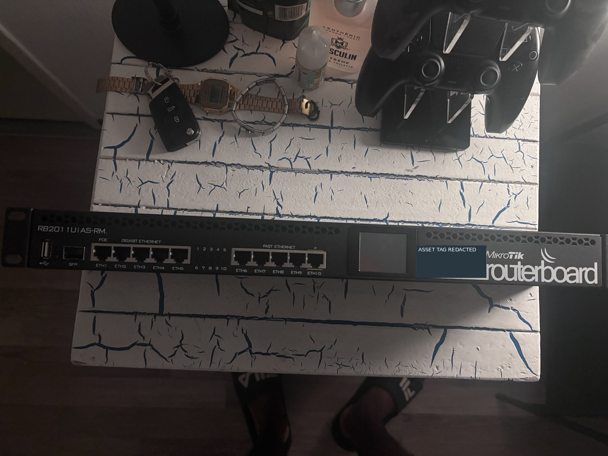

*Figure 1 — The physical MikroTik router used in this project. The asset sticker has been redacted.*

---

## Proposed network topology

My original Packet Tracer design placed the router at the centre, connected to the ISP, two Tenda access points, an additional potential AP, and a self-hosted server. The diagram is a **conceptual layout only**. The RB2011 cannot itself act as a wireless AP; a third AP would have to be a separate physical device.

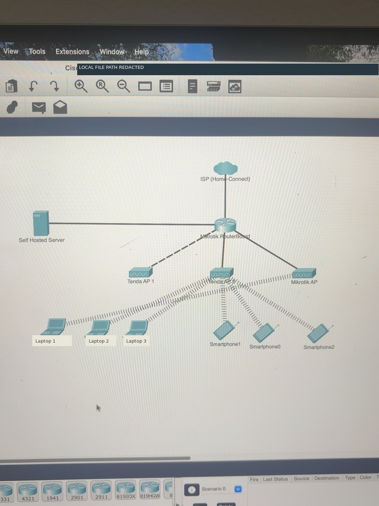

*Figure 2 — Original topology draft. A physical fibre installation also includes the ISP ONT, even though this sketch abstracts that connection.*

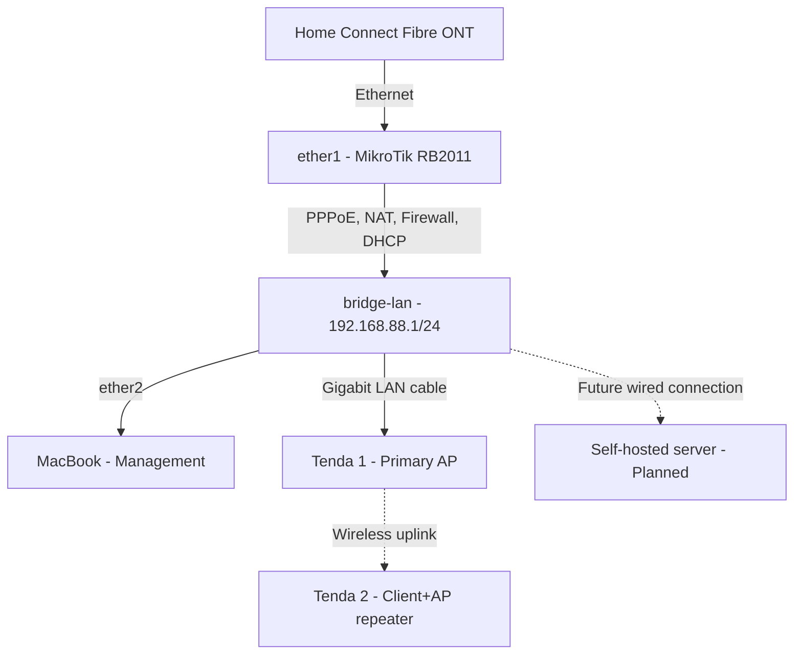

### Port plan

| Port(s) | Role | Status |
|---|---|---|
| `ether1` | WAN / PPPoE | Connected to ONT; internet working |
| `ether2` | MacBook and LAN management | **Verified** |
| `ether3` | Proposed wired primary Tenda AP port | AP configured; exact physical port not verified |
| `ether4` | Spare/possible future wired Tenda uplink | Second Tenda currently uses wireless uplink |
| `ether5` | Future wired server | Bridge assigned; server not connected |
| `ether6`–`ether10` | Spare 100 Mbps LAN ports | Bridge assigned |

---

## 1. First connection: WinBox timeout and Etherboot recovery

I initially connected my MacBook directly to `ether2` but got:

```text
ERR: Could not connect, MacConnection syn timeout
```

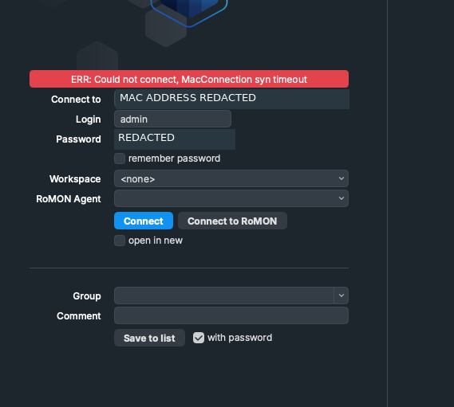

*Figure 3 — WinBox could discover the device but could not establish a MAC session.*

After attempting a reset, the LCD briefly showed **Ether Boot** and WinBox stopped discovering it. A normal power cycle, **without holding reset**, brought the device back into the neighbour list, but the MAC timeout remained.

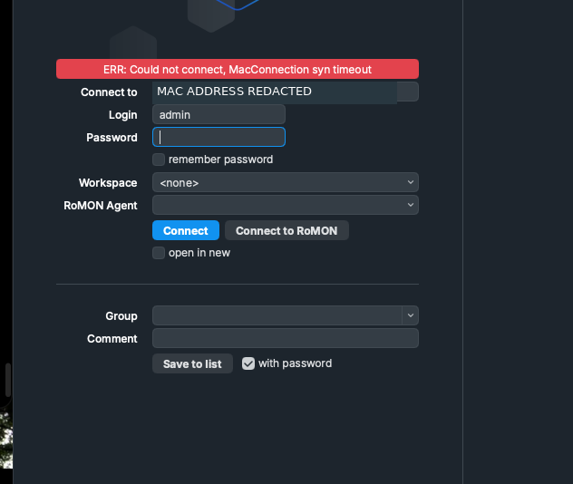

*Figure 4 — MAC-based access still timed out after the RouterBOARD became discoverable again.*

### What I checked

1. Confirmed that the router was powered and Ethernet was connected to `ether2`.
2. Checked the Ethernet adapter in **macOS System Settings → Network**.
3. Found that the MacBook was using a self-assigned `169.254.x.x` address, meaning it had not received a DHCP lease.
4. Configured a temporary static address and connected using the router's IP after the LAN address was configured.

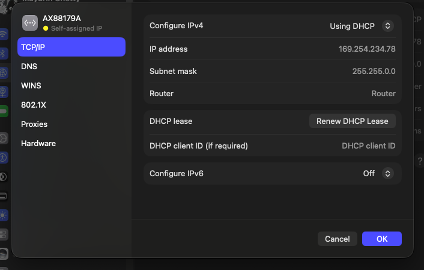

*Figure 5 — Without DHCP, macOS assigned itself a link-local address.*

**Temporary MacBook Ethernet settings:**

| Field | Value |
|---|---|
| IPv4 | Manual |
| IP | `192.168.88.10` |
| Mask | `255.255.255.0` |
| Router / gateway | Left blank while Wi-Fi provided the internet connection |

Keeping the gateway blank allowed **Wi-Fi to supply internet for research/ChatGPT while Ethernet was reserved for WinBox management**. This assumes the active Wi-Fi uses a different subnet from `192.168.88.0/24`.

> **Lesson:** Seeing a MAC address in WinBox Neighbors does not prove that a management connection is working. Check Layer 1, IP addressing, DHCP, interface/bridge state, and MAC-based service restrictions separately.

---

## 2. Building the LAN bridge and assigning an IP

The reset left **IP → Addresses** empty, so there was no management IP or DHCP configuration to rely on.

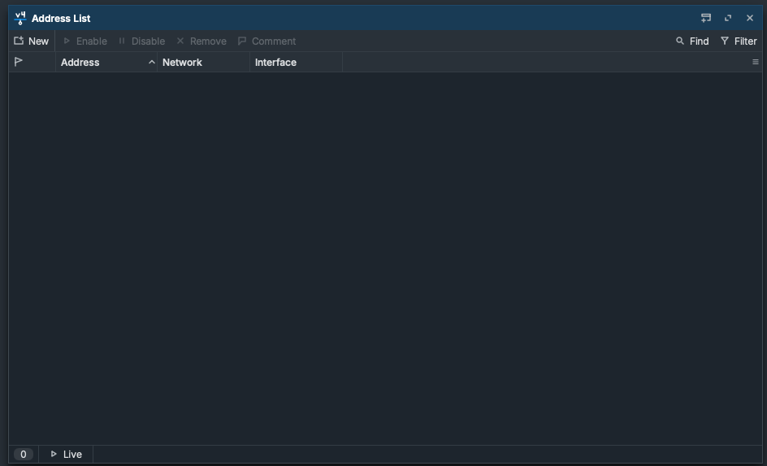

*Figure 6 — No IP addresses were configured after the reset.*

### Step 2.1 — Create the bridge

In WinBox, I opened **Bridge → Bridge → New**, created a bridge named `bridge-lan`, and kept VLAN filtering off for this initial single-LAN setup.

Equivalent CLI (for a **fresh, empty** configuration):

```routeros
/interface bridge add name=bridge-lan vlan-filtering=no
```

### Step 2.2 — Give the bridge its gateway IP

In **IP → Addresses → New**, I configured:

```text
Address:   192.168.88.1/24
Interface: bridge-lan
```

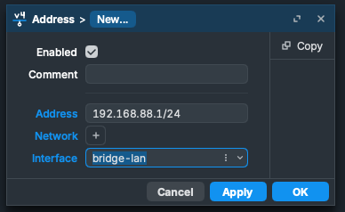

*Figure 7 — The bridge IP address being entered in WinBox.*

Equivalent CLI:

```routeros
/ip address add address=192.168.88.1/24 interface=bridge-lan
```

### Step 2.3 — Add physical interfaces to the bridge

The WinBox Bridge Port dialog showed **`unknown`** and **`no item found`** even though the bridge had been created.

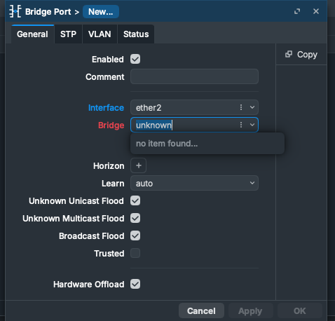

*Figure 8 — A WinBox dropdown issue during port assignment.*

I checked **Bridge → Bridge**, which confirmed that `bridge-lan` existed.

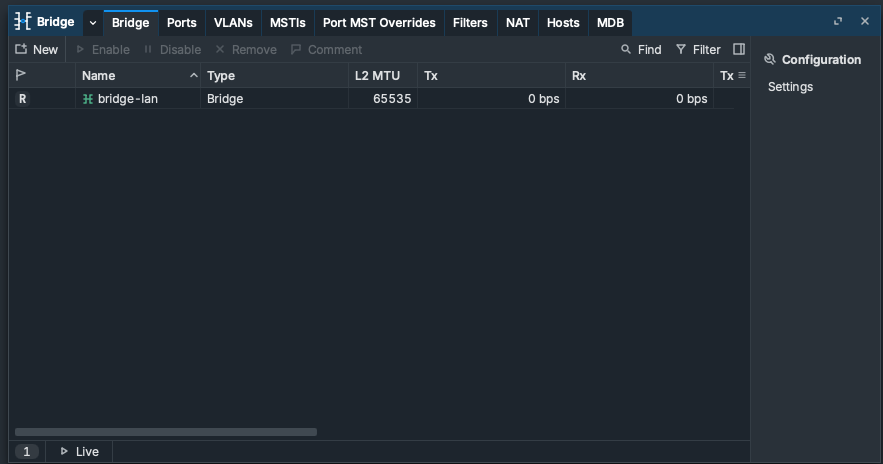

*Figure 9 — `bridge-lan` present and running.*

I worked around the dropdown by using the RouterOS Terminal:

```routeros
/interface bridge port add bridge=bridge-lan interface=ether2
```

Once connectivity was verified, I added the remaining LAN ports:

```routeros
/interface bridge port
add bridge=bridge-lan interface=ether3
add bridge=bridge-lan interface=ether4
add bridge=bridge-lan interface=ether5
add bridge=bridge-lan interface=ether6
add bridge=bridge-lan interface=ether7
add bridge=bridge-lan interface=ether8
add bridge=bridge-lan interface=ether9
add bridge=bridge-lan interface=ether10
```

I deliberately left **`ether1` outside the bridge** for WAN/PPPoE.

To verify:

```routeros
/interface bridge port print
```

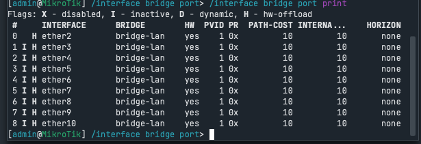

*Figure 10 — `ether2`–`ether10` all assigned to `bridge-lan`. The `H` flag indicates hardware offload and `I` indicates inactive/disconnected interfaces.*

> **Note:** These are historical build commands. Running the same `add` commands again on a configured router can cause “already exists” errors. Check your current state before applying them.

---

## 3. Configure DHCP and verify an actual client lease

I used **IP → DHCP Server → DHCP Setup** and selected `bridge-lan` as the serving interface.

### DHCP settings

| Setting | Value |
|---|---|
| LAN network | `192.168.88.0/24` |
| Default gateway | `192.168.88.1` |
| Address pool | `192.168.88.100`–`192.168.88.250` (planned wizard range; verify against pool configuration) |
| DNS offered to clients | `8.8.8.8`, `1.1.1.1` |
| Lease duration | `1d 00:00:00` |

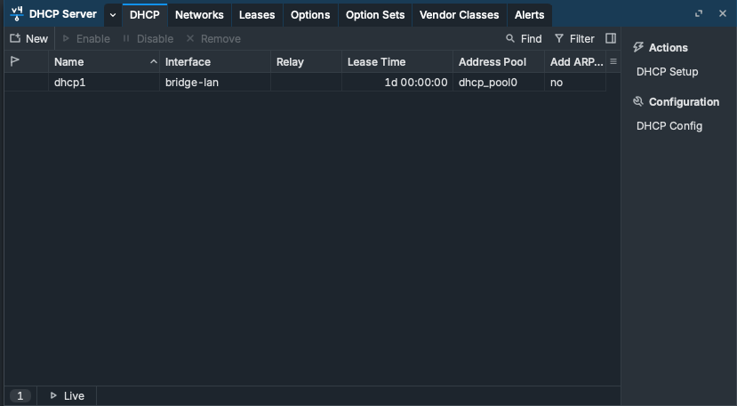

*Figure 11 — `dhcp1` was created on `bridge-lan` with a one-day lease duration.*

On the MacBook I switched Ethernet back to **Using DHCP**. It immediately received:

```text
IP address:   192.168.88.250
Subnet mask:  255.255.255.0
Gateway:      192.168.88.1
DNS servers:  8.8.8.8, 1.1.1.1
```

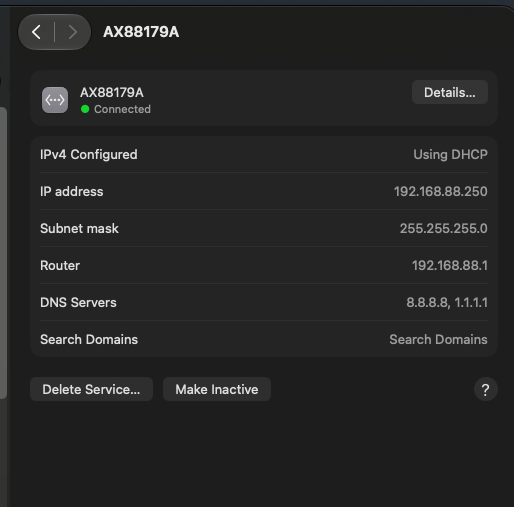

*Figure 12 — The MacBook successfully obtained a DHCP lease from the MikroTik. This is a verified result, not only a configuration screenshot.*

For ongoing configuration, I later used the manual `192.168.88.10/24` address **without an Ethernet default gateway** so Wi-Fi could continue providing internet.

**Verification:** DHCP confirmed working on `bridge-lan`. ✅

---

## 4. Create and verify a basic IPv4 firewall

Before adding rules, **IP → Firewall → Filter Rules** was empty.

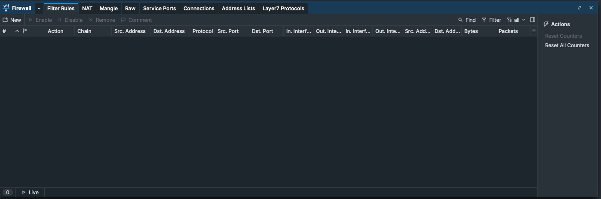

*Figure 13 — A reset-without-defaults configuration initially had no IPv4 filter rules.*

I built a simple rule set with separate `input` (traffic **to** the router) and `forward` (traffic **through** the router) chains.

### Rules used

```routeros
/ip firewall filter
add chain=input action=accept connection-state=established,related,untracked comment="Allow established input"
add chain=input action=drop connection-state=invalid comment="Drop invalid input"
add chain=input action=accept in-interface=bridge-lan comment="Allow LAN management"
add chain=input action=drop comment="Block other input"
add chain=forward action=accept connection-state=established,related,untracked comment="Allow established forwarding"
add chain=forward action=drop connection-state=invalid comment="Drop invalid forwarding"
add chain=forward action=accept in-interface=bridge-lan comment="Allow LAN forwarding"
add chain=forward action=drop comment="Block other forwarding"
```

| Chain | Purpose |
|---|---|
| `input` | Allow established traffic and LAN-originated router management; drop the rest |
| `forward` | Allow established flows and LAN-originated routed traffic; drop unsolicited other traffic |

### Troubleshooting: accidentally duplicated rules

While configuring the firewall, I ended up with **16 rules rather than 8** because the same commands had been entered twice.

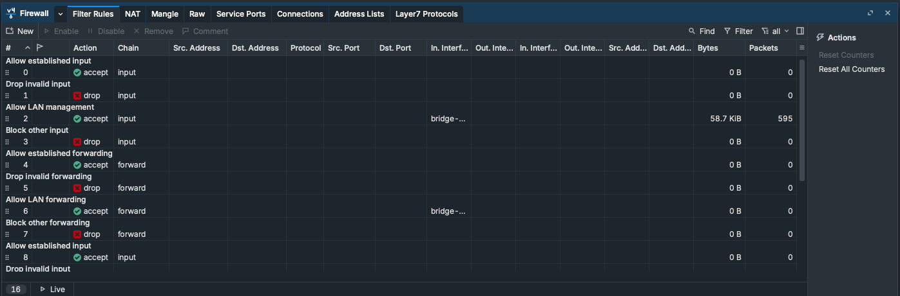

*Figure 14 — Repeated firewall rule sequence begins at entry 8.*

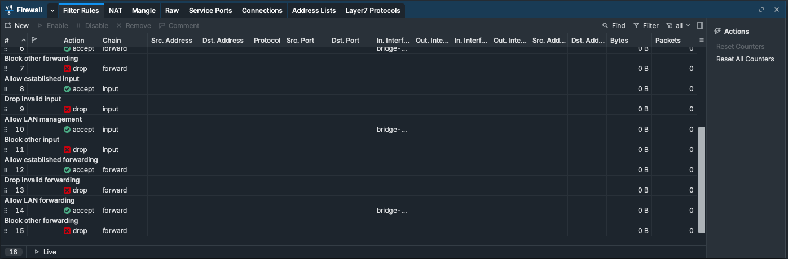

*Figure 15 — The extra sequence continued through entry 15.*

I removed only the duplicate eight rules, leaving the original eight in the correct order.

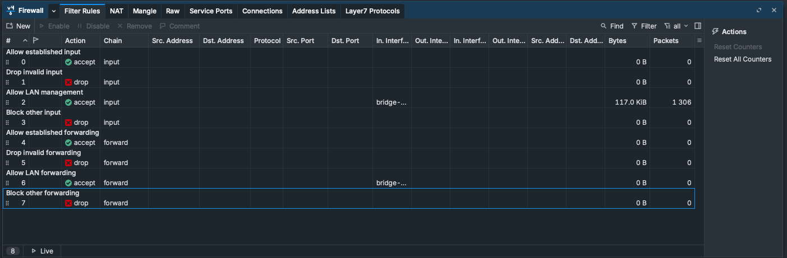

*Figure 16 — Final eight-rule configuration; the LAN input allow rule shows received management traffic.*

**Result:** A basic IPv4 firewall is in place. ✅

> **Scope and caveats:** This configuration is appropriate as an initial one-LAN baseline for this build, not a full multi-VLAN security policy. `Allow LAN forwarding` is broad; guest/IoT VLAN isolation will require more specific rules. Review IPv6 and other services again before enabling additional features. Use **Safe Mode** when making management-sensitive changes.

---

## 5. Create the WAN list and NAT rule

I created a `WAN` interface list, which lets the firewall/NAT refer to the logical internet-facing connection rather than a specific physical port.

```routeros
/interface list add name=WAN
/interface list print
```

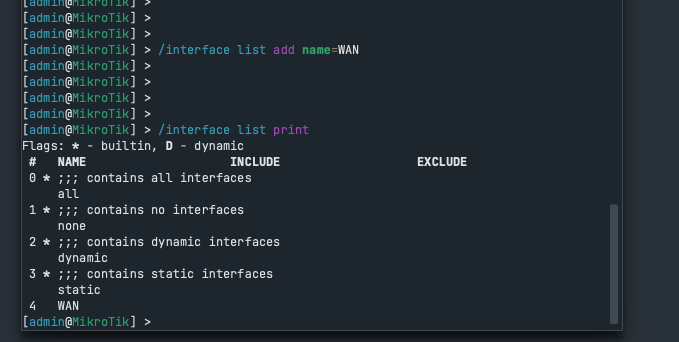

*Figure 17 — `WAN` created as a RouterOS interface list.*

I then added source NAT with masquerading:

```routeros
/ip firewall nat add chain=srcnat action=masquerade out-interface-list=WAN comment="Home Internet NAT"
```

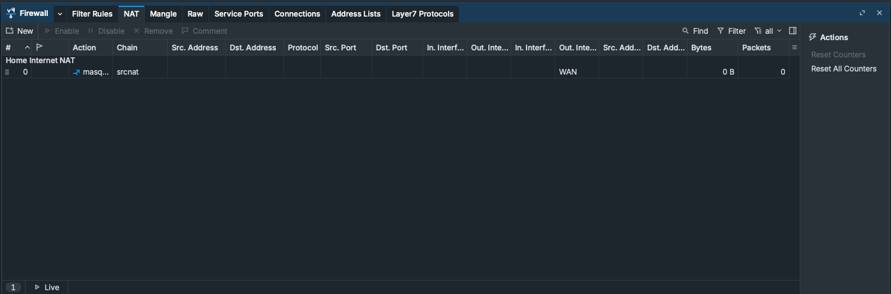

*Figure 18 — Masquerade configured for traffic leaving the WAN list. Counters were zero when the screenshot was taken before the live WAN cutover.*

**Result:** NAT rule created. **Internet connectivity was subsequently reported working after the ONT was connected.**

---

## 6. Harden management: keep WinBox and SSH on LAN only

I wanted CLI access from my MacBook, so I kept **SSH** enabled alongside **WinBox**, rather than disabling all remote management services.

### Before hardening

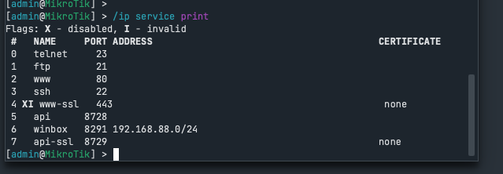

*Figure 19 — Telnet, FTP, HTTP, SSH, API, and WinBox were listed before service restrictions were completed.*

I created the `LAN` interface list and applied access controls:

```routeros
/interface list add name=LAN
/interface list member add list=LAN interface=bridge-lan
/tool mac-server set allowed-interface-list=LAN
/tool mac-server mac-winbox set allowed-interface-list=LAN
/ip neighbor discovery-settings set discover-interface-list=LAN
/ip service set winbox address=192.168.88.0/24
/ip service set ssh address=192.168.88.0/24
/ip service enable ssh
/ip ssh set strong-crypto=yes
/ip service disable [find where name!="winbox" and name!="ssh"]
```

The existing firewall input chain also allows management only from `bridge-lan` and drops other input. Service address restrictions are an additional safeguard.

### IPv6 check

An initial attempt to inspect `/ipv6 settings` and `/ipv6 firewall` returned `bad command name`. Checking installed packages later showed that the **RouterOS 6 IPv6 package was disabled**.

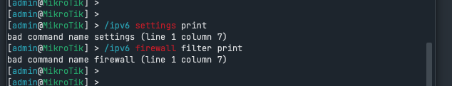

*Figure 20 — IPv6 commands were unavailable before checking the installed packages.*

### After hardening

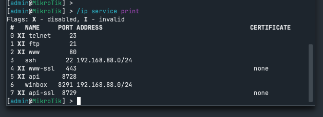

*Figure 21 — Only SSH on port 22 and WinBox on 8291 are enabled; both restrict source IPs to `192.168.88.0/24`.*

Example MacBook connection (once on the local LAN):

```bash
ssh admin@192.168.88.1
```

> **Security note:** Use a strong administrator password, preferably a dedicated non-default management account and SSH keys if supported by the deployed configuration. Never expose SSH/WinBox directly to the public internet. For future off-site administration, prefer a VPN. The screenshot proves the services' configured state, **not that an SSH login test has already passed**.

---

## 7. Upgrade RouterOS manually while the router is offline

The router initially ran **RouterOS 6.47.10**, with architecture **MIPSBE**.

```routeros
/system resource print
/system package print
```

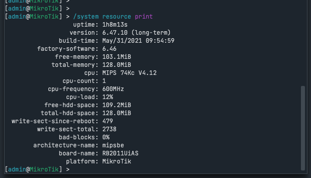

*Figure 22 — Initial RouterOS version and system resources. The RB2011 has 128 MB of RAM and a 600 MHz CPU.*

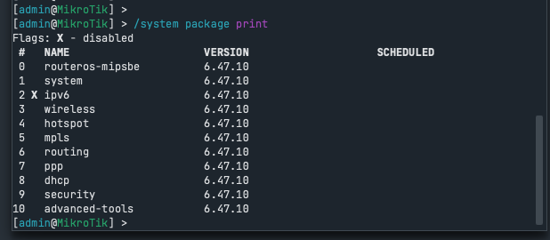

*Figure 23 — RouterOS 6 package listing, including the disabled IPv6 package.*

I used my MacBook's working Wi-Fi connection to download the correct RouterOS update for **MIPSBE**, choosing **6.49.23**, then transferred it over the local Ethernet connection.

### Step-by-step

1. Back up the configuration using `/export hide-sensitive file=before-upgrade` and download the `.rsc` file to the MacBook. **Do not publish configuration backups publicly.**
2. Open the [MikroTik downloads page](https://mikrotik.com/download).
3. Select the **MIPSBE** architecture and **RouterOS 6.49.23**.
4. Download the main **RouterOS `.npk` package**.
5. In WinBox, open **Files** and upload the package to the root of the file list.
6. Reboot using `/system reboot` after verifying the upload.
7. Reconnect and verify using `/system resource print`.

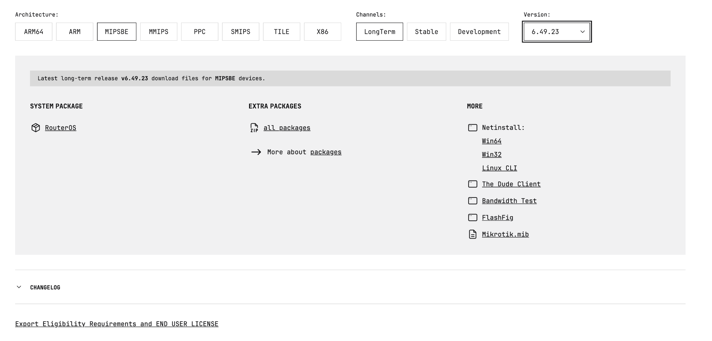

*Figure 24 — Selecting the correct processor architecture and version.*

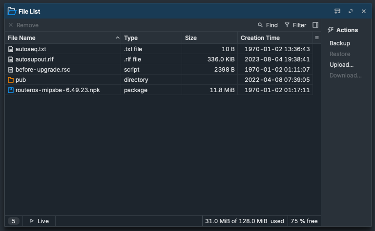

*Figure 25 — The `routeros-mipsbe-6.49.23.npk` package uploaded successfully. The configuration export was kept locally rather than included in this repository.*

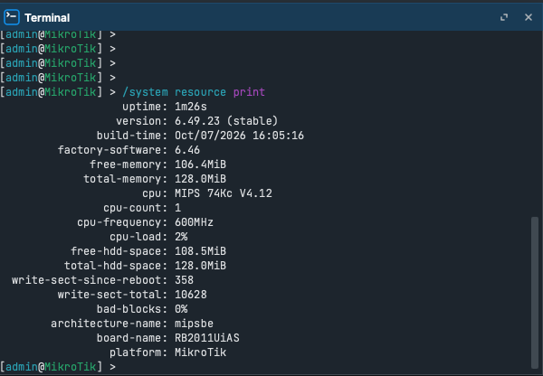

*Figure 26 — RouterOS 6.49.23 running after reboot.*

**Result:** RouterOS upgraded from 6.47.10 to 6.49.23. ✅

---

## 8. Upgrade RouterBOOT firmware

The RouterOS package upgrade was complete, but the bootloader (**RouterBOOT**) still showed `current-firmware: 6.47.10` and `upgrade-firmware: 6.49.23`.

```routeros
/system routerboard print
```

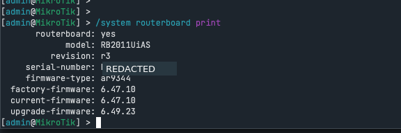

*Figure 27 — RouterBOOT still on the older firmware before the upgrade.*

I ran:

```routeros
/system routerboard upgrade
/system reboot
```

After reboot, I checked the firmware again:

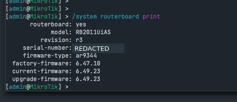

*Figure 28 — Current and available RouterBOOT firmware both show **6.49.23**.*

**Result:** RouterBOOT upgraded successfully. ✅

---

## 9. Configure Home Connect PPPoE

I created a PPPoE client under **PPP → Interfaces → New → PPPoE Client**.

### General tab

| Field | Value |
|---|---|
| Name | `pppoe-homeconnect` |
| Interface | `ether1` **unless the ISP requires WAN VLAN tagging** |
| Enabled | Yes |
| MTU / MRU | Defaults |

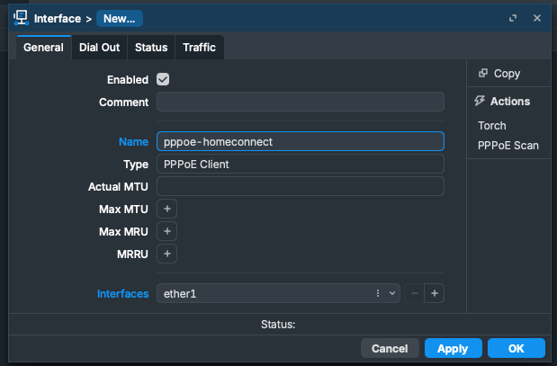

*Figure 29 — PPPoE client created against the intended WAN interface.*

### Dial Out tab

| Field | Configured value |
|---|---|
| Username | ISP-provided (redacted) |
| Password | ISP-provided (redacted) |
| `add-default-route` | Yes |
| `use-peer-dns` | Yes |
| `dial-on-demand` | No |
| Service/AC name | Left blank |
| Default route distance | 1 |

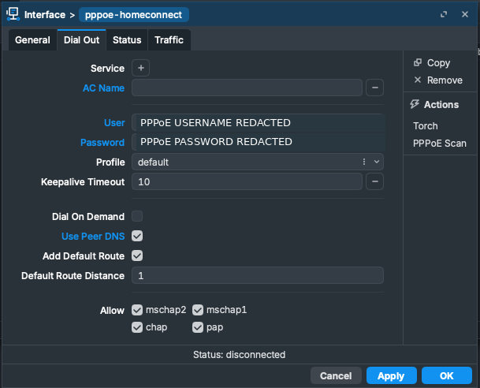

*Figure 30 — PPPoE authentication configured. **Credentials have been redacted** before publication. The client was disconnected at the time of this screenshot because the ONT had not yet been connected.*

### Add PPPoE to the WAN list

```routeros
/interface list member add list=WAN interface=pppoe-homeconnect
/interface list member print
```

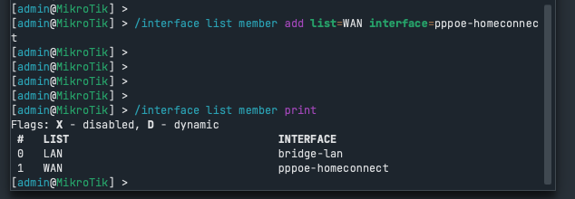

*Figure 31 — `bridge-lan` is in `LAN`, and `pppoe-homeconnect` is in `WAN`.*

> **Important:** The PPPoE password appeared in an original unredacted screenshot during setup. It should be rotated through the ISP before relying on it as a private secret. This repository contains only the **redacted** screenshot.

### ISP VLAN tagging

The PPPoE client was configured on `ether1`, and internet connectivity was later confirmed after connecting the ONT. No additional VLAN tagging was needed for the working configuration described here. Other ISPs or fibre networks may require 802.1Q VLAN tagging.

**Result:** PPPoE client created, assigned to the WAN interface list, and subsequently used for working internet access. ✅

---

## 10. Move the fibre connection to the MikroTik

Once the offline configuration and upgrades were complete, I connected the fibre ONT's Ethernet cable to MikroTik `ether1`. The household then began using the MikroTik as its primary router.

### Cutover sequence

1. Disconnect the ONT's Ethernet cable from the previous router.
2. Connect the ONT to `ether1` on the MikroTik.
3. Keep `ether1` out of `bridge-lan`; it is the WAN port.
4. Use **PPP → Interfaces** to confirm that `pppoe-homeconnect` is enabled.
5. Check PPPoE session information and the WAN list, then test internet access from a LAN client.

Useful verification commands (not captured in a screenshot):

```routeros
/interface pppoe-client monitor pppoe-homeconnect once
/interface list member print
/ip route print
/ip firewall nat print stats
/ping 1.1.1.1 count=4
```

**Observed result:** After connecting the MikroTik to the ONT, **internet access was working**. ✅ This is a reported real-world result; I did not capture a PPPoE status or speed-test screenshot at that point.

---

## 11. Configure Tenda access points and wireless repeating

After the router cutover, I configured the Tenda devices to provide coverage around the house. The primary Tenda is connected by Ethernet to the MikroTik and serves as a normal wireless AP. The second Tenda connects **wirelessly** to the first Tenda.

### Step 11.1 — Primary wired Tenda

1. Connect the primary Tenda to a MikroTik Gigabit LAN port (`ether2`–`ether5`, subject to availability).
2. Open the Tenda's administration page.
3. Select **AP / Bridge mode** when available; do not use WISP on the primary wired AP.
4. Ensure the Tenda is not acting as a second DHCP server or NAT gateway.
5. Set the desired SSID, security mode and Wi-Fi password.
6. Verify that a connected client can access the internet via the MikroTik.

### Step 11.2 — Secondary Tenda with wireless uplink

The secondary Tenda cannot currently be wired back to the MikroTik. I used its wireless repeating function to connect it to the primary Tenda.

1. Open **WiFi Settings → Wireless Repeating** on the secondary Tenda.
2. Enable **Wireless Repeating**.
3. Select **Client+AP** rather than **WISP** for the intended repeat/bridge-style setup.
4. Select the primary Tenda's Wi-Fi network as the **upstream Wi-Fi** and enter its password.
5. Save the configuration and allow the secondary Tenda to reconnect.
6. Configure the secondary broadcast Wi-Fi name/password to match the primary network if the model allows it and one visible SSID is desired.

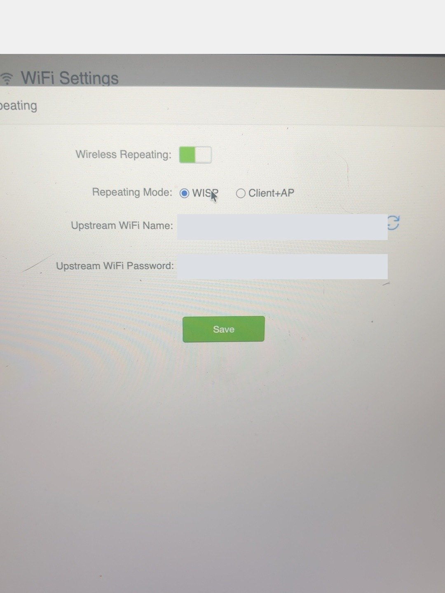

*Figure 32 — The secondary Tenda's wireless repeating page. This screenshot was taken while **WISP was selected**, before the decision to use **Client+AP**; it documents the available settings, not the final selected mode.*

### Why Client+AP instead of WISP?

- **Client+AP** is intended to connect to an upstream Wi-Fi network and retransmit Wi-Fi. Whether it truly bridges client traffic depends on the Tenda model/firmware.
- **WISP** commonly routes/NATs a separate subnet, which is not ideal when a MikroTik is already the main router.
- Reusing the same SSID, password and compatible security settings can make the network appear under one name, **but does not create a coordinated mesh system or guarantee seamless roaming**.
- Wireless repeating generally reduces available throughput compared with wired backhaul.

**Observed result:** The access point setup was reported complete. ✅ The model numbers, final Tenda admin status screens, DHCP assignments of wireless clients and roaming performance were not independently captured; those are useful future evidence to add.

### Validation checklist for future screenshots

- On a phone connected to each Tenda: gateway `192.168.88.1`, address within `192.168.88.0/24`, and internet access.
- In WinBox: **IP → DHCP Server → Leases** to see wireless clients' leases.
- On each Tenda: final working mode, upstream association and Wi-Fi broadcast settings.
- Optional: internet speed tests from clients near each AP and one roaming test.

---

## Current results and outstanding tests

| Check | Status | Evidence |
|---|---|---|
| WinBox connection recovery | ✅ Completed | Figures 3–5 and subsequent login |
| LAN bridge and gateway address | ✅ Completed | Figures 7–10 |
| `ether2`–`ether10` added to LAN bridge | ✅ Completed | Figure 10 |
| DHCP to MacBook | ✅ Verified | Figure 12 (`192.168.88.250`) |
| Firewall with 8 rules | ✅ Configured | Figure 16 |
| WAN NAT masquerade | ✅ Configured | Figure 18 |
| SSH + WinBox restricted to LAN | ✅ Configured | Figure 21 |
| RouterOS upgrade | ✅ Verified | Figure 26 |
| RouterBOOT firmware upgrade | ✅ Verified | Figure 28 |
| PPPoE configuration and interface lists | ✅ Configured | Figures 29–31 |
| Fibre ONT / internet cutover | ✅ Working, reported | Successful live internet after connecting ONT; no new screenshot |
| Primary Tenda AP and secondary repeater | ✅ Setup reported complete | Figure 32 documents repeating configuration screen; final mode not pictured |
| Client IP verification across both Tendas | ⏳ Not captured | Add device/gateway screenshots later |
| Network monitoring / LibreNMS | ⏳ Planned, not installed | Future project |
| Self-hosted server | ⏳ Planned, not deployed | Future project |

## Possible next improvements

1. Capture a redacted successful PPPoE status screen, default-route details and an internet speed test.
2. Capture the **final** AP/repeater configuration and confirm wireless clients receive the MikroTik gateway and DHCP leases.
3. Add SNMP-based network monitoring with LibreNMS on a separate Linux machine or virtual server.
4. Add offline/uptime alerts and router bandwidth monitoring.
5. Evaluate network isolation (guest/IoT/server VLANs) and verify the Tendas support the required VLAN/SSID features before redesigning the firewall.
6. Revisit management hardening, backup strategy and administrative user accounts.

### Troubleshooting notes

- **WinBox MAC timeout:** Test direct Ethernet link, different LAN ports, MAC service restrictions, assigned LAN IP, and IP-based WinBox.
- **Self-assigned `169.254.x.x`:** DHCP was unavailable; a temporary static management IP helped recover access.
- **Etherboot shown during reset:** Avoid prolonged reset-button holds; normal power cycle recovered the router in this case.
- **`bridge-lan` not shown in WinBox dropdown:** Confirm bridge creation, then use `/interface bridge port add ...` if the GUI misbehaves.
- **Duplicate firewall rules:** Inspect `IP → Firewall → Filter Rules` and remove only duplicates; do not blindly reapply setup scripts.
- **No internet after Ethernet is attached to Mac:** Use Wi-Fi for internet and Ethernet for management with no default gateway on the lab Ethernet adapter, if their subnets do not overlap.
- **PPPoE fails after moving ONT:** Check physical link, username/password, provider service state, WAN VLAN requirements, and PPPoE logs before changing firewall rules.
- **Two visible Wi-Fi network names:** Set matching SSIDs, security modes and passphrases on both Tendas where supported; note this is not true mesh networking.
- **Repeater has internet but a different gateway:** Check whether the second Tenda is still routing/NATing (WISP) rather than bridging in its Client+AP implementation.

## Security and publication notes

- No PPPoE passwords, login credentials, device serials, router MAC addresses, personal SSIDs, private file paths, or full configuration backups are intentionally included in the published assets.
- **Credential rotation is recommended** because the PPPoE password was displayed in the original troubleshooting screenshot.
- Running commands from this build log against an already-configured router can create duplicate rules and interfaces; it is a record of what was done, **not an idempotent deployment script**.
- The firewall is an initial IPv4 single-LAN baseline, and policy should be re-evaluated before guest VLANs, new management paths, or public services are enabled.
- RouterOS 6.49.23 was the version installed and verified **on the project date**, not a permanent recommendation for all future installations.

## Official documentation

- [RB2011UiAS-RM hardware/manual](https://help.mikrotik.com/docs/spaces/UM/pages/18350220/RB2011UiAS-RM)
- [RouterOS PPPoE configuration](https://help.mikrotik.com/docs/spaces/ROS/pages/2031625/PPPoE)
- [RouterOS upgrading and installation](https://help.mikrotik.com/docs/spaces/ROS/pages/328142/Upgrading%2Band%2Binstallation)
- [RouterBOOT firmware](https://help.mikrotik.com/docs/spaces/ROS/pages/136839241/RouterBOOT)
- [MikroTik downloads](https://mikrotik.com/download)

---

*This repository documents a working home router and Wi-Fi upgrade, with later network monitoring, self-hosting and VLAN segmentation planned as separate phases.*
